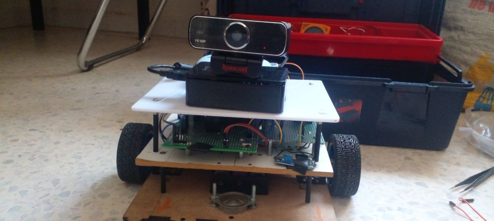
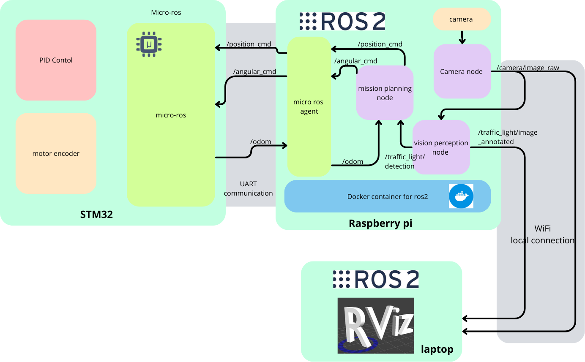
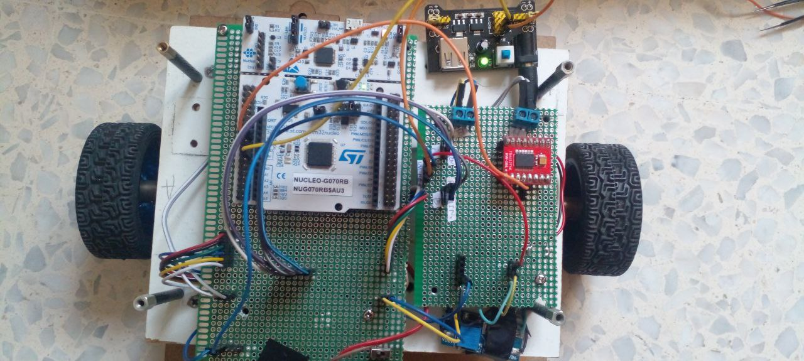
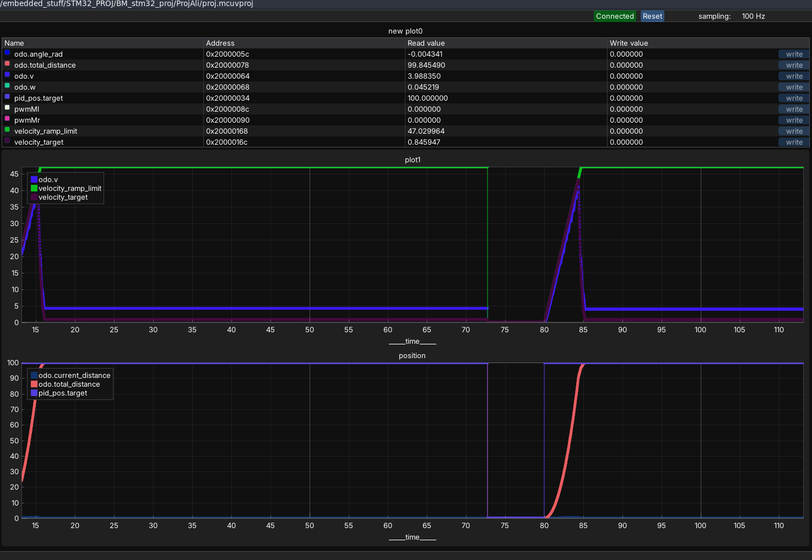
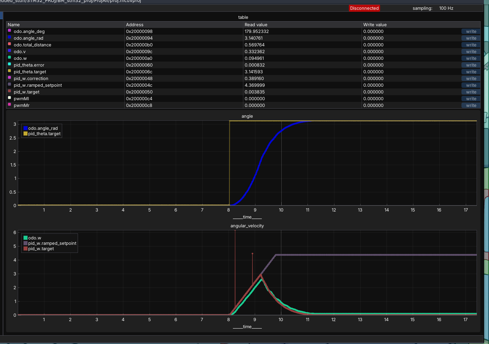
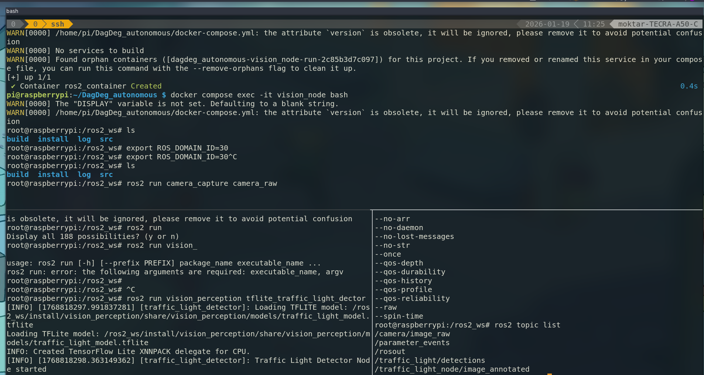
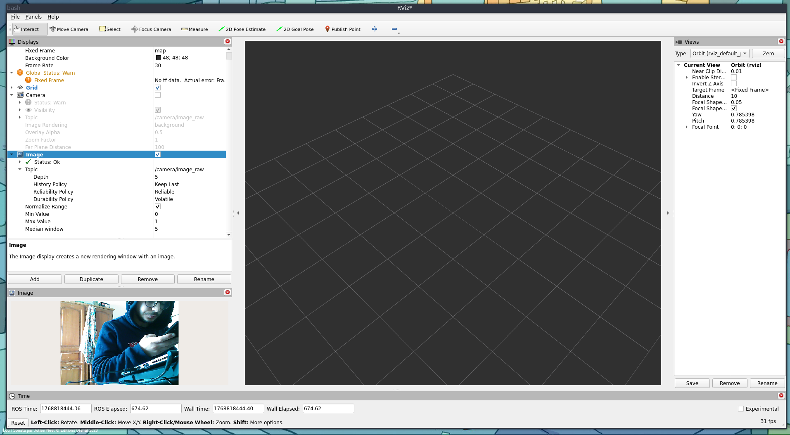
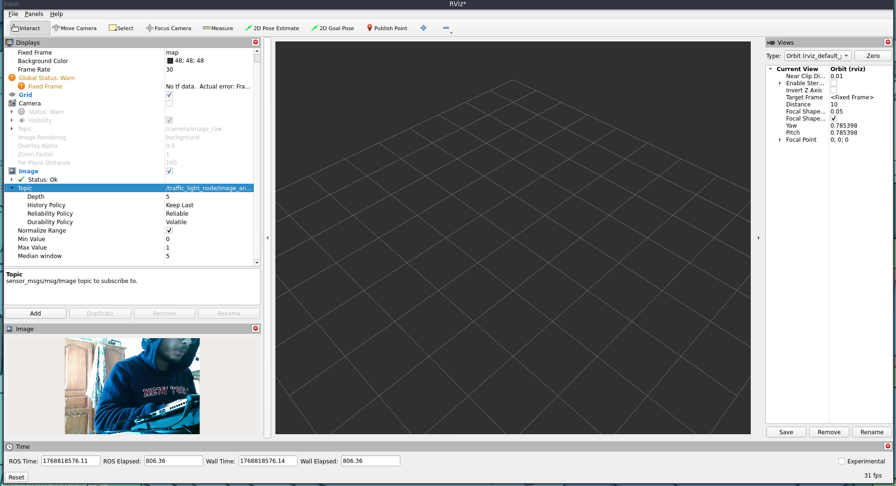
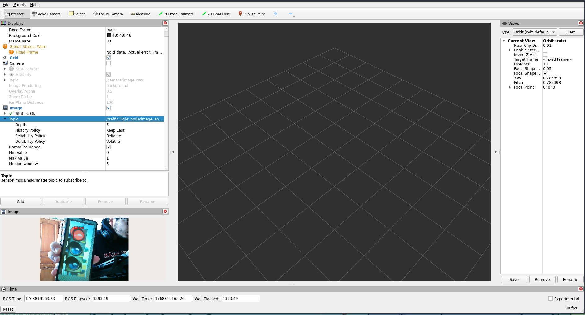

# DagDeg Autonomous Robot with Traffic Light Detection System

# Project Overview

This project implements an autonomous robot capable of detecting and
responding to traffic lights. The system combines embedded bare-metal
programming on STM32 microcontroller with ROS2-based computer vision on
Raspberry Pi, creating a complete autonomous navigation solution.

*Figure: DagDeg Autonomous Robot*

# System Architecture

*Figure: System Architecture Diagram*

The system consists of three main components:

- **STM32 Microcontroller**: Handles low-level motor control, PID
  controllers, and odometry

- **Raspberry Pi**: Runs ROS2 in Docker container with computer vision
  pipeline

- **Laptop**: For visualization using RViz and system monitoring via
  local network

# Hardware Implementation

*Figure: Hardware Overview*

## Robot Fabrication

- Custom chassis design and assembly

- Motor and wheel integration

- Power distribution system

- Camera mounting and positioning

- STM32 microcontroller integration

# STM32 Bare-Metal Development

The low-level firmware was developed using a bare-metal approach to
achieve maximum timing precision. While this allowed for highly
efficient PID loops, it presented a significant challenge for ROS2
integration. The lack of an abstraction layer and an RTOS meant that
`micro-ROS`—which requires specific DMA and task-scheduling
capabilities—could not be utilized. Instead, a custom communication
protocol was developed.

## Developed Drivers

| **Driver**                 | **Description**                                    |
|:---------------------------|:---------------------------------------------------|
| Motor Encoders             | Quadrature encoder interface for position tracking |
| UART Communication         | Serial communication with Raspberry Pi             |
| Clock/System Configuration | Low-level system initialization                    |
| PWM Motor Control          | Precise motor speed control                        |

STM32 Bare-Metal Drivers

## PID Control System

### Position PID Controller

The robot utilizes a **dual-cascaded PID architecture**, featuring
separate loops for position and angular control:

- **Position Control Cascade**: The outer loop controls the absolute
  target position (distance), while the inner loop regulates the linear
  velocity to ensure smooth movement.

- **Angular Control Cascade**: Similar to position control, this manages
  the robot’s orientation, where the outer loop maintains the heading
  angle and the inner loop regulates angular velocity to minimize
  oscillations during turns.

## Odometry Module

- Velocity measurement (linear and angular)

- Position tracking (x, y coordinates)

- Angle calculation (radians and degrees)

- Distance traveled computation

## Velocity Ramping System

A critical aspect of motion control is the implementation of velocity
ramping for both linear and angular velocities. This system ensures
smooth acceleration and deceleration, which is essential for several
reasons:

- **Prevents Wheel Slipping**: Sudden acceleration changes can cause
  wheels to lose traction, especially on smooth surfaces

- **Reduces Mechanical Stress**: Gradual velocity changes minimize
  stress on motors, gears, and mechanical components

- **Improves Energy Efficiency**: Smooth acceleration profiles consume
  less power than jerky movements

- **Enhances System Stability**: Prevents overshoot and oscillations in
  the control system

- **Increases Position Accuracy**: Smooth velocity transitions lead to
  more precise position control

The ramping system was implemented for both linear velocity (`odo.v`)
and angular velocity (`odo.w`) using a two-stage approach:

1\. **Ramp-Limited Setpoint**: A gradually increasing maximum velocity
limit that prevents sudden jumps

2\. **Target Capping**: Ensures the commanded velocity never exceeds
physical or safety limits

*Figure: Linear Velocity Ramping Performance*

*Figure: Angular Velocity Ramping Performance*
*Figure: Velocity Ramping System Performance*

As shown in Figure
<a href="#fig:ramping_performance" data-reference-type="ref"
data-reference="fig:ramping_performance">6</a>, the ramping system
successfully achieves:

- Smooth acceleration from rest to target velocity

- Controlled deceleration when approaching target positions

- Elimination of velocity spikes that could destabilize the system

- Consistent performance across both linear and angular motion

# Traffic Light Detection Model

## Model Development Process

The traffic light detection model was developed using Google Colab,
leveraging the following workflow:

- **Platform**: Google Colab with GPU acceleration

- **Notebook**: Available at
  <https://colab.research.google.com/drive/1lxwcOyEtk-aGk_w2Za_TbaYP-JJjzC9H>

- **Model Architecture**: YOLOv8n (nano variant) for optimal
  speed-accuracy tradeoff

- **Dataset**: RoboFlow traffic light dataset with labeled images

## Training and Optimization

| **Parameter**    |     **Value**     |
|:-----------------|:-----------------:|
| Input Resolution |  640×640 pixels   |
| Batch Size       |        16         |
| Epochs           |        100        |
| Learning Rate    |       0.01        |
| Optimizer        | SGD with momentum |
| Validation Split |        20%        |

Model Training Parameters

## Model Conversion to TensorFlow Lite

To deploy the model on Raspberry Pi with limited computational
resources, the trained YOLOv8 model was converted to TensorFlow Lite
format:

- **Conversion Method**: Direct conversion from PyTorch to TFLite

- **Optimizations**: FP16 quantization for reduced model size

- **Final Model Size**:  7 MB (compressed from original 12 MB)

- **Inference Speed**:  50 ms per frame on Raspberry Pi 4

## Performance Metrics

| **Metric**            | **Value** |
|:----------------------|:---------:|
| mAP@0.5               |   0.72    |
| Precision             |   0.75    |
| Recall                |   0.68    |
| F1-Score              |   0.71    |
| Inference Speed (RPi) |  20 FPS   |

Model Performance Metrics

## Model Architecture Highlights

The YOLOv8n architecture provides an excellent balance for embedded
deployment:

- **Efficient Backbone**: CSPDarknet for feature extraction

- **Path Aggregation Network**: Enhanced feature fusion

- **Anchor-Free Detection**: Simplified output representation

- **Task-Specific Heads**: Optimized for object detection

# ROS2 Implementation on Raspberry Pi

## Docker Container Deployment

The ROS2 ecosystem was deployed on Raspberry Pi 4 using Docker
containers, enabling consistent development environments and simplified
dependency management.

*Figure: SSH connection to Raspberry Pi with Docker container execution showing ROS2 nodes: camera_raw and tflite_traffic_light_detector successfully running with all topics published including /traffic_light/detections*

As shown in Figure <a href="#fig:ros2_ssh" data-reference-type="ref"
data-reference="fig:ros2_ssh">7</a>, the system demonstrates:

- SSH connection to Raspberry Pi from development laptop

- Docker container running ROS2 Humble distribution

- Successful launch of all required nodes

- `camera_raw` node publishing camera feed

- `tflite_traffic_light_detector` node performing real-time inference

- `/traffic_light/detections` topic active with detection information

## Remote Visualization with RViz2

The system supports remote visualization through RViz2 running on a
laptop connected via local WiFi network.

*Figure: RViz2 subscribing to /camera/image_raw topic showing live camera feed*

*Figure: RViz2 subscribing to /traffic_light/image_annotated topic with visualization settings*
*Figure: RViz2 remote visualization from laptop*

Figures <a href="#fig:rviz_raw" data-reference-type="ref"
data-reference="fig:rviz_raw">8</a> and
<a href="#fig:rviz_annotated" data-reference-type="ref"
data-reference="fig:rviz_annotated">9</a> show the remote visualization
capabilities:

- Real-time camera feed visualization via `/camera/image_raw`

- Annotated detection visualization via `/traffic_light/image_annotated`

- Configurable display parameters in RViz2 interface

- Low-latency visualization over local WiFi network

## Traffic Light Detection Results

*Figure: Successful red traffic light detection with bounding box annotation and topic configuration showing subscription to /traffic_light/image_annotated*

Figure <a href="#fig:detection_result" data-reference-type="ref"
data-reference="fig:detection_result">11</a> demonstrates the successful
detection capabilities:

- Red traffic light accurately detected with bounding box

- Annotation showing confidence score and class label

- ROS topic configuration for visualization

- Real-time detection at approximately 20 FPS on Raspberry Pi

## ROS2 Packages

| **Package**        | **Functionality**                                    |
|:-------------------|:-----------------------------------------------------|
| camera_capture     | Publishes raw camera images from Raspberry Pi camera |
| vision_perception  | Traffic light detection and annotation pipeline      |
| traffic_light_node | Main detection node using TensorFlow Lite            |

ROS2 Package Structure

### Topics and Communication

- `/camera/image_raw`: Raw camera feed from Raspberry Pi camera module

- `/traffic_light/node/image_annotated`: Annotated detection images with
  bounding boxes

- `/traffic_light/detections`: Detection data including class,
  confidence, and coordinates

- `/position_cmd`: Position commands to STM32 via UART bridge

- `/angular_cmd`: Angular commands to STM32 via UART bridge

## Docker Container Setup

- Custom Docker image supporting ROS2 Humble with ARM64 architecture

- TensorFlow Lite runtime integration for model inference

- OpenCV for image processing and camera interface

- Complete ROS2 workspace with all dependencies containerized

- Network configuration for remote visualization via RViz2

# System Integration

## Visualization System

- RViz2 for ROS2 visualization over local WiFi network

- Real-time camera feed display with configurable parameters

- Detection bounding box visualization with class labels

- System status monitoring including topic activity and frame rates

- Remote access from any device on the local network

# Challenges and Solutions

## The Bare-Metal Integration Oversight

Developing the STM32 firmware bare-metal was an oversight regarding the
requirements of the ROS2 ecosystem. `micro-ROS` requires an RTOS and
complex DMA configurations that are difficult to implement from scratch
in bare-metal C. The solution involved creating a custom UART
communication protocol between the STM32 and Raspberry Pi.

## Real-Time and System Stability Performance

- **Challenge**: Ensuring real-time PID control on bare-metal STM32

- **Solution**: Optimized interrupt handling, efficient algorithms, and
  velocity ramping system

## Model Deployment on Resource-Constrained Hardware

- **Challenge**: Limited computational resources on Raspberry Pi for
  real-time inference

- **Solution**: Model quantization to TensorFlow Lite format, efficient
  memory usage, and optimized pipeline

# Conclusion

This project successfully demonstrates a complete autonomous system
integrating:

- Bare-metal embedded programming on STM32 with sophisticated velocity
  ramping

- Advanced PID control with smooth motion profiles

- Custom-trained YOLOv8 model for traffic light detection with 72% mAP
  accuracy

- Efficient deployment using TensorFlow Lite on embedded Raspberry Pi
  hardware

- ROS2-based system architecture with Docker containerization

- Remote visualization via RViz2 over local WiFi network

- Successful real-time detection of traffic lights with annotated
  visualization

The velocity ramping system proved crucial for stable operation, while
the custom traffic light detection model achieved sufficient accuracy
for reliable real-world performance. The Docker-based ROS2 deployment on
Raspberry Pi enabled consistent development and deployment, while remote
RViz2 visualization allowed for convenient system monitoring. The
integration of these components creates a robust autonomous platform
suitable for various navigation applications.

# Repository Links

- **Odometry and STM32 Code**:
  <https://github.com/Onizuka09/OdometryRobot>

- **ROS2 and AI Implementation**:
  <https://github.com/Onizuka09/DagDeg_autonomous>

- **Model Training Notebook**:
  <https://colab.research.google.com/drive/1lxwcOyEtk-aGk_w2Za_TbaYP-JJjzC9H>
